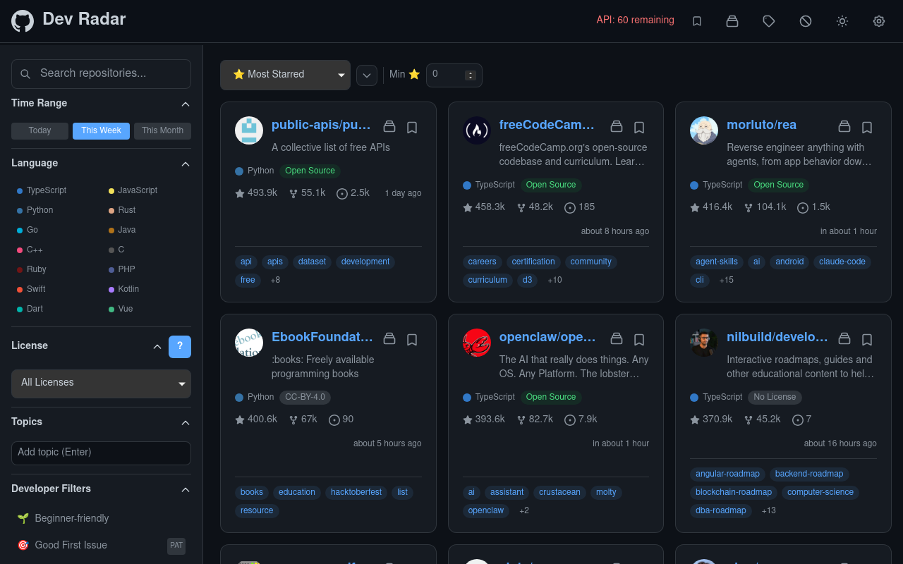

<!-- markdownlint-disable MD013 MD060 -->

# Dev Radar

## Stop hunting for cool repos. Start discovering them.

A native Linux desktop client for exploring GitHub — filter the trending landscape by language, license, stars, and topics, bookmark gems, organize collections, ignore noise. All client-side, no backend, your data stays on your machine.



[](https://react.dev)
[](https://www.typescriptlang.org)
[](https://vite.dev)
[](https://tailwindcss.com)
[](https://tauri.app)
[](#install-linux-package)

---

## Features

### 📈 Trending Feed

Discover repositories updated in the last **24 hours**, **7 days**, or
**30 days** sorted by stars — no GitHub trending page needed.

- ⏱️ Time range selector: **Today** / **This Week** / **This Month**
- > ⏱️ 30 days is the upper limit because GitHub has no official trending API.
  > Beyond a month, `pushed:>YYYY-MM-DD stars:>50 sort:stars` returns the
  > all-time most-starred repos (React, Vue, etc.) every time — the "trending"
  > signal disappears. Shorter windows surface repos actively gaining traction.
- ♾️ Infinite scroll pagination via `IntersectionObserver`, with a manual
  "Load more" fallback when many pages get filtered out client-side
- 📱 Fully responsive: 1 column (mobile), 2 columns (tablet), 3 columns (desktop)

### ✨ Sorting

| Sort                     | Description                         |
|--------------------------|-------------------------------------|
| ⭐ **Most Starred**       | Descending by stargazer count       |
| 🍴 **Most Forked**        | Descending by fork count            |
| 🕐 **Recently Updated**   | Last push date descending           |
| ✨ **Best Match**         | GitHub relevance ranking            |

### 🔍 Filters

| Filter          | How it works                                          |
|-----------------|-------------------------------------------------------|
| **Language**    | Multi-select from curated list, maps to API query     |
| **License**     | Dropdown: All, Open Source Only, No License, or specific (MIT, Apache-2.0, GPL-3.0, etc.) |
| **Topic tags**  | Free-text chip input → `topic:<tag>` in query         |
| **Min Stars**   | Number input in sort bar — filter by minimum star count |
| **Archived**    | Show/hide archived repos (hidden by default)          |
| **Forks**       | Show/hide forked repos (hidden by default)            |
| **README Lang** | All Languages / English Only (client-side detection, requires PAT) |

### 🧠 Developer-Centric Filters

Ten purpose-built filters applied client-side for detection that
GitHub search qualifiers can't express:

| Filter                | Icon | What it finds                               |
|-----------------------|------|---------------------------------------------|
| **Beginner-friendly** | 🌱   | Low complexity, learning-oriented            |
| **Good First Issue**  | 🎯   | Repos with labeled good-first-issues         |
| **Actively Maintained**| 🔧  | Recent commits, active contributors          |
| **Solo Project**      | 👤   | Single/small-team maintained                 |
| **Production Ready**  | 🚀   | Stable, licensed, widely used                |
| **AI/ML**             | 🤖   | Machine learning, LLMs, neural networks      |
| **Indie Project**     | 🎨   | Small, creative, independent projects        |
| **New & Exploding**   | 💥   | Recently created projects with stars           |
| **Low Competition**   | 💎   | Undiscovered gems with quality signals       |
| **Enterprise**        | 🏢   | Large-scale, cloud-native, infrastructure    |

### 👤 Personalization

All data stored in `localStorage` — no backend required.

- 🔖 **Bookmarks** — save repos for later with one click
- 📂 **Collections** — organize repos into custom groups
- 👁️ **Followed Topics** — recommendations based on followed topics
- 🚫 **Ignore List** — hide repos matching unwanted topics/languages
- 🔗 **Shareable URLs** — every filter/sort combo is uniquely bookmarkable

### 🎨 UI & Accessibility

- 🌙 **Dark mode by default** with light toggle (persisted, respects
  system preference)
- 🌐 **Russian / English interface** — instant switch in Settings, remembered
  on the machine, date-fns relative dates and `Intl` numbers follow the choice
- 🗂️ **Collapsible sidebar** with all filters — hamburger menu on mobile, sticky on desktop
- ⌨️ Full keyboard navigation and ARIA labels
- 🪟 Accessible modal panels — `role="dialog"`, Escape to close, focus moves into the dialog
- 💀 Skeleton loading states (never a blank screen)
- ⚠️ Error states with retry buttons and rate-limit countdowns
- 🗳️ Empty states with reset-filters CTAs

---

## Tech Stack

| Layer             | Choice                                                  |
|-------------------|---------------------------------------------------------|
| **Framework**     | React 19 + Vite 7                                       |
| **Language**      | TypeScript 6                                            |
| **Styling**       | Tailwind CSS 3                                          |
| **Data Fetching** | TanStack Query 5 with infinite scroll                   |
| **Routing**       | React Router 7                                          |
| **Dates**         | date-fns 4                                              |
| **Testing**       | Vitest 4 + React Testing Library + MSW 2                |
| **Linting**       | ESLint 10 with typescript-eslint                        |
| **Desktop Shell** | Tauri 2 (Linux: deb + AppImage)                         |

---

## Project Structure

```text
src/
├── App.tsx                      # Route table with lazy-loaded pages
├── components/
│   ├── Icons.tsx                  # SVG icon components
│   ├── I18nProvider.tsx           # Language provider, syncs <html lang>
│   ├── Panel.tsx                  # Reusable accessible modal panel
│   ├── RepoCard.tsx               # Individual repo display card
│   ├── RepoGrid.tsx               # Grid layout with infinite scroll
│   ├── FilterSidebar.tsx          # Collapsible sidebar with all filters
│   ├── SearchInput.tsx            # Debounced keyword search
│   ├── MinStarsInput.tsx          # Debounced minimum-stars input
│   ├── LanguageBadge.tsx          # Color-coded language indicator
│   ├── LicenseBadge.tsx           # Open source / proprietary badge
│   ├── LicenseLegend.tsx          # License legend panel
│   ├── BookmarksPanel.tsx         # Saved repos modal
│   ├── CollectionsPanel.tsx       # Collection manager modal
│   ├── FollowedTopicsManager.tsx  # Topic following modal
│   └── IgnoreListManager.tsx      # Ignore list modal
├── hooks/
│   ├── useAuth.ts                 # React binding for auth revision store
│   ├── useI18n.ts                 # i18n context accessor
│   ├── useClickOutside.ts         # Detect clicks outside an element
│   ├── useRepos.ts                # TanStack Query infinite data hook
│   ├── useFilters.ts              # URL-synced, validated filter state
│   ├── useSort.ts                 # URL-synced, validated sort state
│   ├── usePersonalization.ts      # Preference store hooks + selectors
│   └── useTheme.ts                # Dark/light mode hook
├── lib/
│   ├── authStore.ts               # PAT store with cross-tab sync
│   ├── github.ts                  # REST + GraphQL API client
│   ├── i18n.ts                    # ru/en dictionaries, plural rules, locale init
│   ├── utils.ts                   # Formatting helpers (locale-aware)
│   ├── constants.ts               # Options, licenses, dev filters
│   ├── developerFilters.ts        # Client-side filter evaluation
│   ├── languageColors.ts          # Language dot color map
│   ├── licenseLegend.ts           # Open source license guide
│   ├── readmeLanguage.ts          # English README detection
│   ├── openExternal.ts            # Open links in system browser (Tauri aware)
│   └── userPreferences.ts         # Preference store + CRUD
├── pages/
│   ├── Home.tsx                   # Main trending feed
│   └── Settings.tsx               # PAT input, preferences
├── types/
│   └── github.ts                  # API response types
├── __mocks__/
│   └── handlers.ts                # MSW handlers for testing
└── __tests__/                     # Unit + component tests
```

Desktop shell:

```text
src-tauri/
├── Cargo.toml                     # Rust package `dev-radar` (lib `dev_radar_lib`)
├── tauri.conf.json                # window 1280x800, bundle: deb + appimage, identifier
├── capabilities/default.json      # permission grants (opener)
├── icons/                         # app icons generated by `tauri icon`
└── src/
    ├── main.rs                    # binary entry point
    └── lib.rs                     # Tauri builder + tauri-plugin-opener
```

---

## Install (Linux)

Prebuilt `.deb` / AppImage packages are on the roadmap (Phase 5). Until then, build locally —
one command, a few minutes on first run:

```bash
npm ci && npm run tauri:build
sudo apt install "src-tauri/target/release/bundle/deb/Dev Radar_0.1.0_amd64.deb"
```

Or run the portable AppImage straight from `src-tauri/target/release/bundle/appimage/`:

```bash
chmod +x "Dev Radar_0.1.0_amd64.AppImage"
./Dev\ Radar_0.1.0_amd64.AppImage
```

The AppImage bundles its own libraries and needs FUSE; where FUSE is unavailable, run it with
`APPIMAGE_EXTRACT_AND_RUN=1` (it then unpacks to a temp dir on every start).

The `.deb` uses the system WebKitGTK (~5 MB). The AppImage carries a copy (~82 MB) so it runs on
machines without the Tauri dev libraries installed.

---

## Build from source

### Prerequisites

Web build: **Node.js** >= 22, **npm** >= 9.

Desktop build also needs **Rust** 1.90+ and the Tauri Linux libraries:

```bash
sudo apt install libwebkit2gtk-4.1-dev libgtk-3-dev libayatana-appindicator3-dev librsvg2-dev patchelf
```

### Install

```bash
git clone https://github.com/Zulus-Code/dev-radar.git
cd dev-radar
npm ci
```

### Development

```bash
npm run dev
```

Opens at <http://localhost:5173>.

### Build

```bash
npm run build
```

Output goes to `dist/`.

### Desktop app (Tauri 2)

The same SPA runs as a native Linux window via Tauri. Requires Rust 1.90+ and the
usual Tauri Linux dependencies (`libwebkit2gtk-4.1-dev`, `libgtk-3-dev`,
`libayatana-appindicator3-dev`, `librsvg2-dev`, `patchelf`).

```bash
npm run tauri:dev    # dev window against the Vite dev server
npm run tauri:build  # release binary + deb/AppImage under src-tauri/target/release/bundle/
```

External links open in the system browser through `@tauri-apps/plugin-opener`;
in a plain browser they fall back to `window.open`.

### Preview production build

```bash
npm run preview
```

---

## GitHub API & Authentication

The app uses both **REST** (search) and **GraphQL** (enrichment) APIs. Most features work without authentication, but providing a GitHub Personal Access Token unlocks the full experience.


### What a PAT unlocks

| Without PAT                          | With PAT                                          |
|--------------------------------------|---------------------------------------------------|
| 60 requests/hour (Core API)          | 5,000 requests/hour (Core API)                   |
| 10 requests/minute (Search API)      | 30 requests/minute (Search API)                  |
| Basic search results only            | Enriched repo data (PR/issue counts, languages)  |
| No README language detection         | English README detection enabled                  |

### How to get one

1. Go to **GitHub Settings → Developer settings → Personal access tokens → Tokens (classic)** (or Fine-grained tokens)
2. Give it a name, set expiration, and select **"Only select repositories"** (or no repo access — the token only reads public data)
3. No scopes needed for public data; add `Metadata: Read` if prompted
4. Copy the token and paste it in the app's **Settings** page (`/settings`) — it is validated against GitHub before saving, so invalid or expired tokens are rejected immediately

The token is stored in **`localStorage`** and sent **only** to GitHub API endpoints.

> ⚠️ Never commit tokens to source control. `.env.local` is gitignored.

---

## Testing

182 tests covering store logic, URL validation, query building, pagination,
component rendering, filter logic, language detection, and i18n (dictionary
parity, Russian plurals, locale resolution, live language switching).

```bash
# Run all tests
npm test

# Watch mode
npm run test:watch

# Run a single test file
npx vitest run src/__tests__/utils.test.ts

# Type-check without emitting
npm run typecheck

# Lint
npm run lint
```

### Test stack

| Tool                    | Purpose                  |
|-------------------------|--------------------------|
| **Vitest 4**            | Test runner              |
| **React Testing Library**| Component testing       |
| **MSW 2**               | API mocking (REST + GQL) |
| **jsdom**               | DOM environment          |

---

## Scripts

| Command                    | Action                     |
|----------------------------|----------------------------|
| `npm run dev`              | Start dev server           |
| `npm run build`            | Type-check + build         |
| `npm run preview`          | Preview production build   |
| `npm test`                 | Run all tests              |
| `npm run test:watch`       | Tests in watch mode        |
| `npm run typecheck`        | TypeScript type check      |
| `npm run lint`             | ESLint                     |
| `npm run tauri:dev`        | Run the Tauri desktop app  |
| `npm run tauri:build`      | Build deb + AppImage       |

---

## Roadmap

| Phase | What                                                                  | Status  |
|-------|-----------------------------------------------------------------------|---------|
| 0     | CI on Node 22, drop sort options the API cannot honour                | ✅ done |
| 1     | Native Tauri 2 shell, `.deb` + AppImage, external links to the browser | ✅ done |
| 2     | Russian UI with a ru/en switch                                        | next    |
| 3     | SQLite star snapshots — real star deltas instead of "recently pushed" | planned |
| 4     | Filter presets and per-preset themes                                  | planned |
| 5     | Release publishing, autostart, packaging polish                       | planned |

Details and acceptance criteria: [`docs/PLAN.md`](./docs/PLAN.md).

## About this fork

Dev Radar is a fork of [plamen5rov/github-dashboard](https://github.com/plamen5rov/github-dashboard) (MIT).
Upstream remains the original browser dashboard; this repo turns it into a native Linux client.
Credits to the original author for the React app, the API layer and the test suite.

---

## License

MIT — see [LICENSE](./LICENSE).
